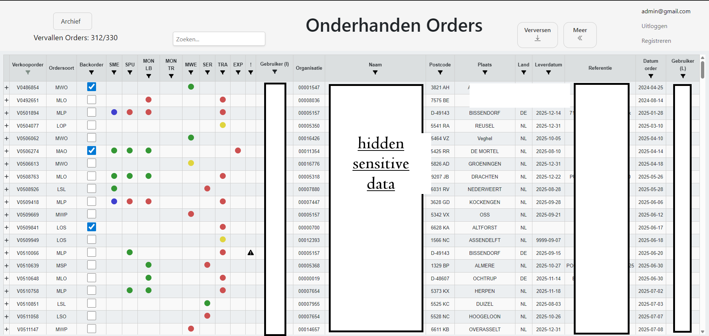
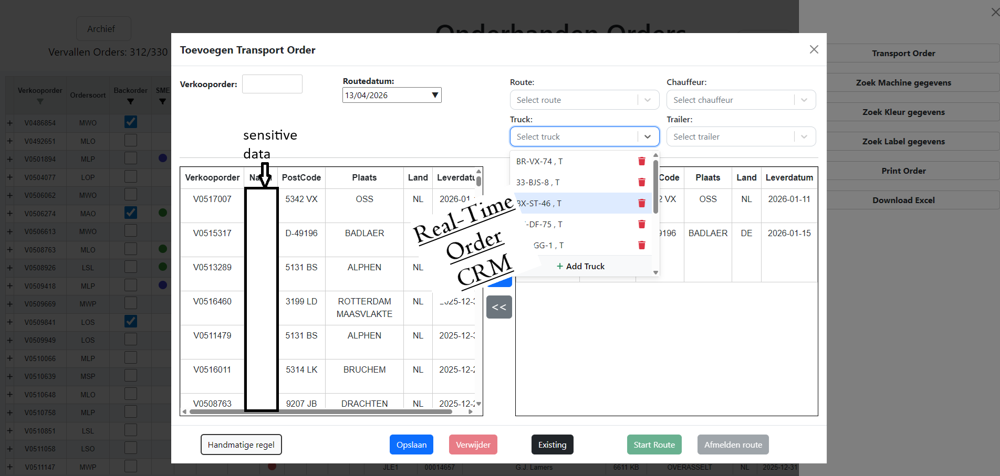
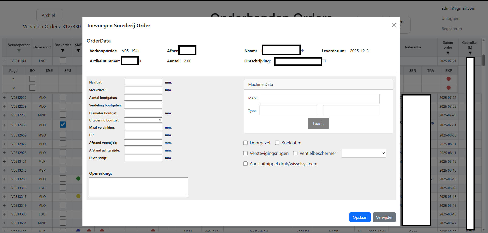
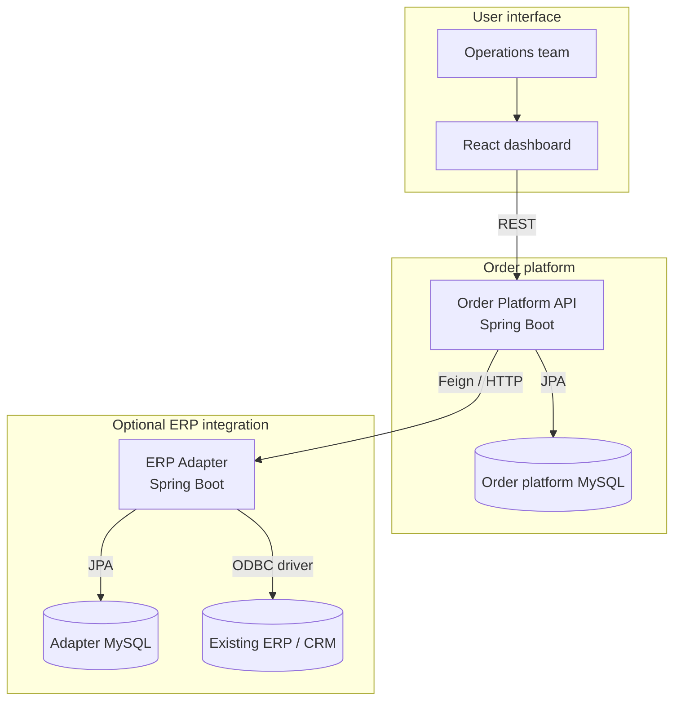

# Order Operations Platform

A web platform for coordinating order workflows across operations departments. It combines a React dashboard, a Spring Boot API, and an ERP integration adapter.

## What it does

- Presents order and department workflows in a shared operations dashboard.
- Supports archive, transport planning, exports, PDFs, and printing workflows.
- Publishes live workflow updates to connected dashboard clients.
- Refreshes ERP/CRM data through a separate adapter that connects to the existing ERP source over ODBC.

## Screenshots

### Orders dashboard



### Transport planning



### SME order setup



## Architecture



The dashboard sends queries and commands to the API over REST; the API pushes live updates back over SockJS/STOMP. For ERP refreshes, the API calls the adapter over Feign/HTTP, and the adapter accesses the ERP through its configured vendor driver. The adapter and its database are enabled by the Compose `erp` profile. This diagram shows application relationships, not a production deployment topology.

### Components

| Component | Responsibility | Main technologies |
| --- | --- | --- |
| `frontend` | Order dashboard, live updates, transport and archive workflows | React 18, JavaScript, Axios, SockJS/STOMP |
| `backend/appts` | Authentication, orders, workflow coordination, transport, archive, and maintenance | Java 8, Spring Boot 2.7, Spring Security, JPA, MySQL |
| `backend/appts2` | ERP/CRM queries and normalized integration endpoints | Java 8, Spring Boot 2.7, JDBC/ODBC, MySQL |
| `infra` | Local development stack | Docker Compose |

### Repository layout

```text
.
├── .github/workflows/       CI for backend and frontend checks
├── backend/
│   ├── appts/                Main Order Platform API
│   └── appts2/               ERP integration adapter
├── docs/
│   ├── screenshots/          Dashboard and workflow screenshots
│   └── *.md                  Architecture, API, and domain references
├── frontend/                 React dashboard
├── infra/                    Docker Compose and environment template
├── .gitignore
├── LICENSE
└── README.md
```

## ERP and ODBC integration

The ERP integration requirement is to retrieve order and CRM information from an existing ERP system through its ODBC interface. The adapter owns the provider-specific connection and query logic, then returns normalized data to the main API over HTTP.

Live integration requires the ERP vendor's driver, a compatible runtime, the private connection URL or DSN, and credentials. The proprietary driver and connection details are not included in this repository. Configure the adapter with:

- `APP_ERP_ODBC_DRIVER_CLASS_NAME`
- `APP_ERP_ODBC_URL`
- `APP_ERP_ODBC_USERNAME`
- `APP_ERP_ODBC_PASSWORD`

The adapter Docker image contains the application and Java runtime, but not the vendor driver. Supply that driver in the adapter runtime image before enabling the Compose `erp` profile. The main dashboard and API can run without the profile; operations that refresh ERP/CRM data require a configured adapter.

## Prerequisites

- JDK 8 or newer for backend development
- Maven 3.8+ to run the ERP adapter directly; the main API includes a Maven Wrapper
- Node.js 18+ and npm for the dashboard
- Docker Desktop with Docker Compose for the local stack
- MySQL for direct component runs
- ERP driver and connection settings for live ERP integration

## Configuration

Environment files ending in `.env.example` are templates, not credentials. The applications do not load these templates automatically.

| Use | Template |
| --- | --- |
| Docker Compose stack | `infra/.env.example` |
| Main API, direct run | `backend/appts/.env.example` |
| ERP adapter, direct run | `backend/appts2/.env.example` |
| React dashboard, direct run | `frontend/.env.example` |

For Compose, copy the infra template to the ignored `infra/.env`, replace every placeholder, and keep real credentials private. Direct runs should receive the relevant variables through the shell, IDE, or deployment environment. The templates include database settings, the JWT secret, CORS and frontend URLs, and ERP ODBC settings.

## Run locally with Docker Compose

From the repository root in PowerShell:

```powershell
Copy-Item infra\.env.example infra\.env
# Replace all placeholders in infra\.env before starting.
docker compose --env-file infra\.env -f infra\docker-compose.yml up --build
```

The default stack starts MySQL for the order platform, the main API, and the dashboard. To also start the adapter and its MySQL database, first provide the ERP driver in the adapter image and set the ERP values in `infra/.env`, then run:

```powershell
docker compose --profile erp --env-file infra\.env -f infra\docker-compose.yml up --build
```

Local endpoints:

| Application | URL |
| --- | --- |
| Dashboard | `http://localhost:3000` |
| Order Platform API | `http://localhost:9090/api` |
| ERP adapter | `http://localhost:8080/api/feign` (with the `erp` profile) |

Stop the stack with:

```powershell
docker compose --env-file infra\.env -f infra\docker-compose.yml down
```

## Run and test components directly

Main API:

```powershell
Set-Location backend\appts
.\mvnw.cmd test
.\mvnw.cmd spring-boot:run
```

The application run requires its database and environment variables from `backend/appts/.env.example`. On macOS or Linux, use `./mvnw` instead of `.\mvnw.cmd`.

ERP adapter (requires Maven, its application database, and ERP connection settings):

```powershell
Set-Location backend\appts2
mvn test
mvn spring-boot:run
```

The adapter unit tests do not require access to a live ERP source. Running the application does require the vendor driver and a valid connection.

Frontend:

```powershell
Set-Location frontend
npm ci
npm test -- --watchAll=false
npm run build
```

The CI workflow runs the main API tests, adapter tests, frontend tests, and frontend production build. Keep the Maven wrapper and npm lockfile; dependency and build output directories are ignored.

## Deployment

The included Compose configuration is for local development and binds HTTP services to localhost. A deployed environment should provide HTTPS termination, secret management, database access controls, and monitoring. Hibernate schema update is the current default; select and validate a migration strategy before deploying against persistent data. Flyway migrations for the main API are present but disabled by default.

## Documentation

- [Architecture](docs/architecture.md)
- [Domain model](docs/domain-model.md)
- [API contracts](docs/api-contracts.md)

## License

Proprietary; intended for Usama Ghori's portfolio and private use. No reuse license is granted for the project's original material. Third-party materials remain subject to their own terms. See [LICENSE](LICENSE).
